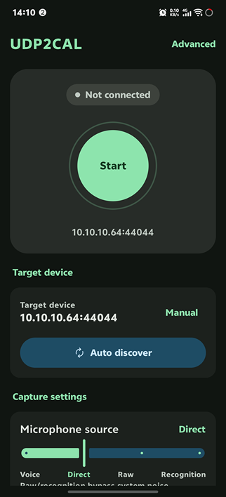
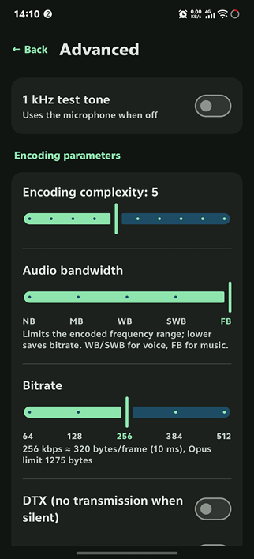
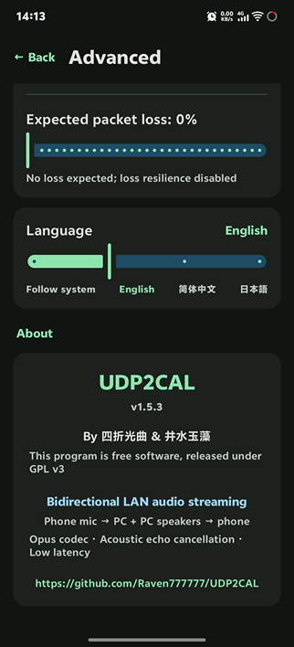
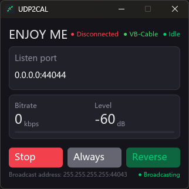

# UDP2CAL
***Bidirectional Audio Streaming over LAN***

**[中文](README.zh.md) | English**

Use an Android phone as your PC's microphone and speaker: the phone's mic audio is Opus-encoded and sent over the LAN to the PC's virtual sound card, while the PC's speaker audio is streamed back to the phone's earpiece.

```
Android phone ↔ bidirectional audio ↔ Windows PC
  Forward:  phone mic → Opus encode → UDP → PC → WASAPI → VB-Cable → any application
  Reverse:  PC speakers → WASAPI Loopback → Opus encode → UDP → phone earpiece/speaker
```

---

> ### Legacy phone support
>
> This repository only maintains the Android 10+ `android/` client together with its matching `windows/` and `protocol/` code.
>
> For **Android 6–8 legacy phones**, download the app and Windows software from **[Release v1.1.1](https://github.com/Raven777777/UDP2CAL/releases/tag/v1.1.1)**; the two must be used as a pair — the old app cannot connect to the current PC side.

---

## Components

| Directory          | Description                                                                                                     | Requirements                                   |
| ------------------ | --------------------------------------------------------------------------------------------------------------- | ---------------------------------------------- |
| `windows/`         | Windows receiver (Rust + iced), WASAPI playback / loopback capture, lives in the system tray                  | Windows 10+, VB-Cable virtual audio device     |
| `android/`         | Android client (Kotlin + Jetpack Compose), full Opus parameter panel                                           | Android 10 (API 29)+                           |
| `opus-src/`        | libopus 1.6.1 source tree (single copy shared by Android JNI and Windows — do not keep another copy inside it)  | —                                              |
| `vendor/`          | Local copies of `audiopus` / `audiopus_sys` (with local patches, referenced via `[patch.crates-io]` — do not overwrite with upstream) | —                                              |
| `protocol/`        | Protocol v3 crate: control plane + RTP media plane (single source of truth; Android reuses the same implementation via JNI) | —                                              |

---

## Quick start

```bat
build.bat win --release                              :: build the Windows receiver
build.bat android --abi arm64-v8a --release          :: build the Android client
build.bat doctor --fix                               :: environment check with auto-fix
```

Run `build.bat` without arguments for the interactive menu.

**Development**: Windows Rust 1.96+, VS Build Tools 2022, CMake 3.22+; Android JDK 17–22, Android SDK 35, NDK 27.0.12077973, plus the Rust `aarch64-linux-android` target (the protocol layer is cross-compiled into `libudp2cal_protocol.so`, see [docs/BUILD.md](docs/BUILD.md))

---

## Documentation

All technical documentation lives in [`docs/`](docs/README.md). (Documents are in Chinese.)

| Document                                       | Contents                                                              |
| ---------------------------------------------- | --------------------------------------------------------------------- |
| [docs/BUILD.md](docs/BUILD.md)                 | Requirements, common `build.bat` commands and options, build artifacts, FAQ |
| [docs/FEATURES.md](docs/FEATURES.md)           | Features of both sides, Opus parameters in detail, screenshots        |
| [docs/ARCHITECTURE.md](docs/ARCHITECTURE.md)   | Project layout, tech stack, runtime behavior, code map, naming conventions |
| [docs/PROTOCOL_V3_RTP.md](docs/PROTOCOL_V3_RTP.md) | **Protocol spec (current)**: RTP media plane, control plane, clock model |
| [docs/LATENCY_CALIBRATION.md](docs/LATENCY_CALIBRATION.md) | Latency definitions, `playhead_ts` and DMA buffers, measurement/calibration procedure |
| [docs/PERF_PROFILE.md](docs/PERF_PROFILE.md) | CPU profiling tools and benchmark baselines |
| [docs/CHANGELOG.md](docs/CHANGELOG.md)         | Version history                                                       |
| [docs/BUGFIX.md](docs/BUGFIX.md)               | Root-cause archive of bugs in the current code                        |
| [docs/LEGAL.md](docs/LEGAL.md)                 | Copyright, GPL-3.0 licensing, third-party component licenses          |
| [docs/archive/](docs/archive/)                 | Historical archive: v2 protocol, migration plans, past review reports, old fix notes |

---

| android-modern-main                                          | android-modern-settings                                          | android-modern-legal                                          |
|:---------------------------------------------:|:---------------------------------------------:|:---------------------------------------------:|
| |  |  |

| windows-main                                          |
|:---------------------------------------------:|
| |

---

## License

© 2026 UDP2CAL Contributors. This program is free software released under the **GNU General Public License v3.0**, see [`LICENSE`](LICENSE); third-party open-source licenses are listed in [docs/LEGAL.md](docs/LEGAL.md).
