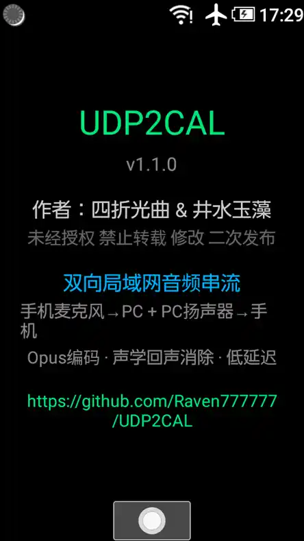
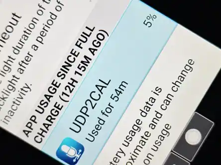

# Android Old 低性能版（`android_old/`）

> 适用于 Android 6~8（API 21~26）旧设备 / 翻盖机，支持双向音频串流
> 相关文档：[功能特性](FEATURES.md) · [构建说明](BUILD.md) · [架构说明](ARCHITECTURE.md)

---

## 一、定位

现代版 `android/` 依赖 Jetpack Compose 与较新系统 API（minSdk=29），无法覆盖 2015-2017 年前后的低端机与翻盖机。`android_old/` 是专门为这一区间设备定制的精简版本：传统 View 布局、minSdk=21、JNI 编解码 + 帧合并 + CPU 自动降级。

| 对比项 | `android/`（现代版） | `android_old/`（低性能版） |
|--------|---------------------|---------------------------|
| minSdk / targetSdk | 29 / 35 | 21 / 26 |
| UI | Jetpack Compose + Material 3 | 传统 View + AppCompat |
| 采集采样率 | 固定 48kHz | 48kHz（可降级至 8k） |
| 帧长 | 10ms | 40ms（2 帧合并） |
| Opus 参数面板 | 全参数可调 | 固定均衡配置（complexity=1、DTX、VBR） |
| CPU 保护 | 无 | `/proc/self/stat` 每 2s 检测，>40% 渐进降级 |
| 交互 | 触摸 | 十字键（适配物理键盘翻盖机） |

---

## 二、功能

- 自动搜索局域网内的 PC 接收端（UDP 广播发现）
- 一键自动连接，无需手动输入 IP/端口
- 音源优先尝试 VOICE_COMMUNICATION（系统硬件降噪），失败自动回退 MIC 裸采集
- **低延迟优化**：AudioTrack 缓冲 300ms→80ms，AudioRecord 缓冲减半，保活/CPU 检测低频化
- 低性能设备默认配置（Opus 复杂度 1、DTX 开启、VBR 自动码率）
- **双向音频串流** — 手机麦克风 → PC VB-Cable，PC 扬声器 → 手机听筒
- **独立音频路径** — 正向/反向使用独立 UDP 端口 + 独立协程，互不阻塞
- **自动反向端口协商** — CONNECT 包携带反向端口，Windows 端自动发现
- 十字键上下音量控制，适配翻盖机
- 左右键显示程序介绍页面

&nbsp;&nbsp;

---

## 三、性能优化

### 目标设备

| 项目 | 值 |
|------|------|
| 制造商 / 型号 | SHARP NP805SH（翻盖机） |
| SoC | Qualcomm Snapdragon 210 (MSM8909) |
| CPU | 4× Cortex-A7 @1.1GHz (ARMv7, 32-bit) |
| RAM | 1GB (914 MB 可用) |
| Android | 8.1.0 (API 27) |
| ABI | armeabi-v7a |

### 性能演进

| 阶段 | 配置 | CPU | 编码线程 | 温度 |
|:----|------|:--:|:--------:|:----:|
| 🔴 原始 | 48kHz / 20ms 帧 / 每帧 ACK | **117-120%** | R 97.9% | 35→37°C↑ |
| 🟡 首次优化 | 16kHz / complexity=1 / 40ms 帧 / ACK 限频 | **~9%** | S 4.4% | 36°C 稳定 |
| 🟢 **最终定型** | **48kHz / complexity=1 / Fullband / 256kbps / 40ms 帧 / JNI 修复** | **~14%** | **S 13.9%** | **37°C 稳定** |



### 关键优化项

| 优化 | 手段 | 效果 |
|------|------|------|
| ACK 轮询开销 | 每 10 帧（~5Hz）检查一次，`soTimeout` 1→5ms | CPU 开销降至 1/50 |
| 编码频率 | 合并 2 帧为 40ms 打包编码 | 50 → 25 帧/秒 |
| 帧长正确性 | JNI 改用实际数组长度作为帧大小 | 修复 40ms 帧降调 |
| 忙等 | `read <= 0` 时 `delay(1)` 让出 CPU | 消除 100% 忙等 |
| 屏幕休眠 | WakeLock `acquire()` 无限期持有 | 熄屏不断连 |
| 负载自适应 | 每 2s 读 `/proc/self/stat`，>40% 渐进降级 | FB→SWB→WB→MB，256→128→64→32kbps |

### 延迟优化（2026-06-09）

| 优化项 | 优化前 | 优化后 |
|:------|:------:|:------:|
| AudioTrack 缓冲 | 300ms + minBufSize×2 ≈ 600ms | **80ms** + minBufSize ≈ 120ms |
| AudioRecord 缓冲 | minBufSize×2 ≈ 80ms | **minBufSize** ≈ 40ms |
| 正向延迟 | ~600ms | **~120ms** |
| 反向延迟 | ~600ms | **~150ms** |

> 后续全链路低延迟优化将该数据进一步压缩至 50~80ms，详见 [BUGFIX.md](BUGFIX.md)。

---

## 四、技术要点

- 传统 Android View 布局（无 Jetpack Compose）
- minSdk=21, targetSdk=26, compileSdk=34
- Kotlin + AndroidX AppCompat
- Opus 编码器/解码器通过 JNI（C/NDK）编译
- 正向/反向双向 Opus 编解码（独立 socket + 独立协程）
- AudioTrack 听筒播放（USAGE_MEDIA，不改 AudioManager 模式）
- 立体声解码 + 下混单声道：`opus_jni_decoder.c` 接收 `channels` 参数，Kotlin 层 `(L+R)/2` 下混，适配旧版单声道 AudioPlayer

---

## 五、构建

### 通过统一入口

```bat
build.bat android --old --abi armeabi-v7a --release
build.bat android --old --abi arm64-v8a --release
build.bat android --old --abi armeabi-v7a --debug
```

### 独立构建

```bat
:: armeabi-v7a（32位，推荐旧设备）
gradlew assembleRelease -PtargetAbi=armeabi-v7a

:: arm64-v8a（64位）
gradlew assembleRelease -PtargetAbi=arm64-v8a
```

APK 路径：`app/build/outputs/apk/release/app-release.apk`

> 环境要求：JDK 17~22、Android SDK 35、NDK 27.0.12077973。详见 [BUILD.md](BUILD.md)。

---

## 六、已知限制

- 无 Opus 参数现场调节面板，参数固定为均衡配置；如需调整须改 `Prefs.kt` 默认值后重新编译
- 反向音频单声道播放（旧设备 AudioTrack 限制），PC 端立体声数据在端侧下混
- CPU 自动降级触发后编码带宽下降，可能带来可感知的音质损失（属预期保护行为）
- 目标系统为 API 21~26，API 29+ 设备建议使用现代版
