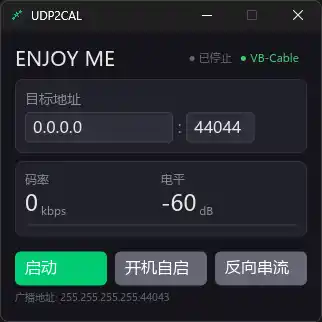
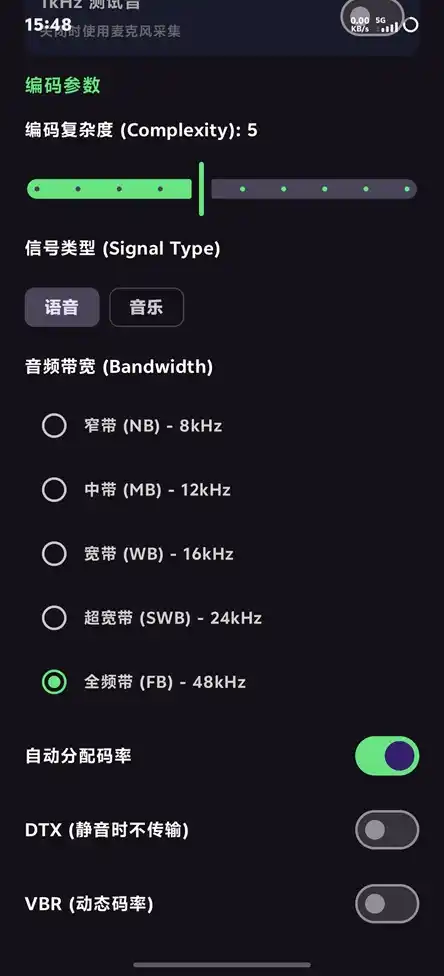

# 功能特性

> 相关文档：[构建说明](BUILD.md) · [架构说明](ARCHITECTURE.md) · [协议规范](PROTOCOL_V3_RTP.md)

---

## 一、系统概述

```
Android 手机 ↔ 双向音频 ↔ Windows PC
  正向: 手机麦克风 → Opus 编码 → UDP → PC → WASAPI → VB-Cable → 任意应用
  反向: PC 扬声器 → WASAPI Loopback → Opus 编码 → UDP → 手机听筒/扬声器
```

**双向、低延迟**的局域网音频串流。协议为 v3（标准 RTP/Opus，固定 48 kHz / 10 ms）：
**声卡播放头是唯一音频时钟**，音频路径上没有应用层 PCM 队列、没有定时器、没有墙钟。

三条设计主线：

- **时钟**：播放头（而非定时器）决定何时解码/PLC/校正；漂移由受控重采样连续吸收，
  离散丢/插只作为 1 ms/s 的有界兜底；
- **参数**：编码参数运行中热更新（≤100 ms），只有需要换采集源的项才重建链路；
- **独占**：一台 PC 同一时刻只服务一台手机，异设备静默拒绝。

---

## 二、Android 发送端（`android/`）

- **音源自适应**：仅一个 `isVoiceMode` 状态驱动音源决策。语音模式 → `VOICE_COMMUNICATION`
  （系统硬件降噪 + AEC），全频模式 → `MIC` 裸麦直出；异常时回退 MIC 保底
- **声学回声消除**：语音模式启用 `AcousticEchoCanceler` + `MODE_IN_COMMUNICATION`，
  AudioRecord 与 AudioTrack 绑定同一 session
- **参数热更新**：发送循环每 100 ms 对齐一次 Prefs。码率/复杂度/带宽/DTX/VBR/VBR 约束/
  FEC/丢包率直接 `OPUS_SET_*`，下一帧生效、不断流；语音↔音乐与测试音开关要换
  AudioRecord 音源 / AEC / AudioTrack 通路，走 restart 通道重建（约 1 s 重连）
- **纯直通无软件处理**：AudioRecord → 直通拷贝 → Opus 编码，APP 端无降噪/AGC/音效代码，
  硬件降噪由系统全权托管
- **发送路径每帧零分配**：帧缓冲与发送缓冲在会话开始时一次性分配，
  `encoderEncodeTo` 直接写进 RTP 头之后的偏移，不做中间拷贝
- **Opus 参数可调**：码率五档（默认 256 kbps）、带宽五档、复杂度 1–10、VBR/DTX/FEC/丢包率，
  采样率与帧长固定 48 kHz / 10 ms
- **设置面板实时反馈**：面板内嵌状态卡片，显示音源、已生效的码率/带宽/VBR 模式、
  实时码率与反向串流状态；手机调参同时同步到 PC 反向编码器（CONNECT 每秒刷新）
- **1 kHz 测试音**：内置正弦波发生器，无需麦克风即可验证端到端链路
- **JNI `@Synchronized`**：编解码器句柄串行访问，杜绝并发闪退
- **UDP 广播发现**：v3 控制包发现 Windows 接收端，端口取自 DISCOVER_REPLY
- **P2P 双向保活**：控制协程每 1 s 发 `TYPE_CONNECT`（携带反向端口 + Opus 参数）；
  ACK 由独立阻塞线程收取；3 s 无 ACK 判断开
- **优雅断连**：断连不退出采集，持续发 CONNECT 等待重连，收到 ACK 自动恢复
- **持久化设备 ID**：8 字节标识，SharedPreferences 存储，用于连接绑定


---

## 三、Windows 接收端

- **Rust + iced 原生 UI**：暗色主题、实时电平、单行状态栏
- **单一解码实例**：48 kHz 单声道、10 ms 帧；v3 不再按采样率切换解码器
- **事件驱动 PLC**：缺口在播放头到期时才补，连续 12 帧后转静音但仍在 PLAYING；
  真实包到达立即恢复（Deep PLC 神经网络模型运行时激活）
- **两级漂移校正**：受控重采样（±0.5%，每 10 ms 更新）为主，1 ms/s 有界回落（交叉淡化）兜底；
  取代旧的 500 ms 丢/插 5 ms
- **总延迟可视化**：状态栏实时显示 `延迟 N ms`；日志每 10 s 打印"水位 + 声卡缓冲 +
  比率微调 + 回落次数"的构成分解
- **反向串流**：UI 按钮控制 PC→Phone 启停，开关持久化到注册表；码率/带宽/DTX 等由
  CONNECT 同步，**仅在变化时**应用到反向编码器（`OPUS_SET_*` 每次调用都会重置内部状态）
- **反向链路诊断**：每 30 s 输出发包数/字节数/编码错误/超限丢弃/丢样/发送错误
- **VB-Cable 自动检测**：优先 VB-Cable，缺失时回退默认输出设备
- **系统托盘**：关闭隐藏到托盘、右键退出、双击恢复；托盘不可用时直接退出
- **P2P 独占**：
  - 双状态机：广播（Ready 周期广播 / Silent 停止）+ 连接（Idle 监听 / Busy 独占）
  - `TYPE_CONNECT` 唯一准入；设备 ID 一对一过滤 + 互斥锁防抢占
  - **防抢占静默拒绝**：BUSY 时异设备 CONNECT 不回 ACK → 新设备 `isAckFresh()` 恒 false →
    不编码不发送；已有连接的保活与音频流完全不受影响
- **控制面与媒体面分离**：15 B 控制头（`0x03`）与 12 B RTP 头（PT=111）共用 socket，按首字节解复用
- **二进制发现**：监听 44043，`DISCOVER_REPLY` 携带 listen_port + 设备名
- **注册表持久化**：开机自启、监听地址/端口、设备 ID、反向串流开关
- **初始化状态检测**：解码器 / WASAPI 初始化失败实时反馈到 UI
- **防火墙自动放行**（静默 `NETSH`，无 CMD 窗口）
- **单实例互斥**：`CreateMutexW` 防止重复启动



---

## 四、Opus 编码器参数（Android 设置面板）

| 参数 | 默认值 | 可选值 | 说明 |
|------|--------|--------|------|
| **编码复杂度** | 10 | 1~10 滑块 | 1=最省 CPU，10=最佳质量。局域网推荐较高 |
| **信号类型** | 语音 | 语音 / 音乐 | 语音模式启用系统硬件降噪(NS+AGC)+AEC；音乐模式裸麦直出。**切换需重建采集链路** |
| **音频带宽** | 全频带 FB | 五档滑块 NB 8k / MB 12k / WB 16k / SWB 24k / FB 48k | 限制编码频率范围，越低越省码率。语音推荐 WB/SWB |
| **码率** | 256 kbps | 五档滑块 64 / 128 / 256 / 384 / 512 kbps | 上限 512 kbps（10 ms 帧下 640 字节/帧，远低于 Opus 1275 字节上限），两端同值钳制 |
| **VBR** | 关闭(CBR) | 开启 / 关闭 | 静音时自动降码率省带宽；开启 DTX 时强制 VBR |
| **VBR 码率约束** | 无约束 | 无约束 / 约束 | 约束时 VBR 不超过目标码率，无约束时允许临时突增 |
| **DTX** | 关闭 | 开启 / 关闭 | 静音段停止传输。开启后强制 VBR |
| **FEC** | 关闭(0) | 关闭 / 开启(2) | 提高丢包容忍度，弱网适用；开启时附带 DRED 深度冗余。局域网建议关闭以降低延迟 |
| **预期丢包率** | 0% | 0~30% 滑块 | 告知编码器丢包率，FEC 开启时按此比例插冗余。局域网设 0% 可免冗余开销 |
| **采样率 / 帧长** | 48000 Hz / 10 ms | 固定不可调 | v3 不协商；PC 输出设备非 48 kHz 由 `AudioWriter` 重采样 |

> 除"信号类型"和"测试音"外，所有参数在运行中热更新，无需重启采集流。


